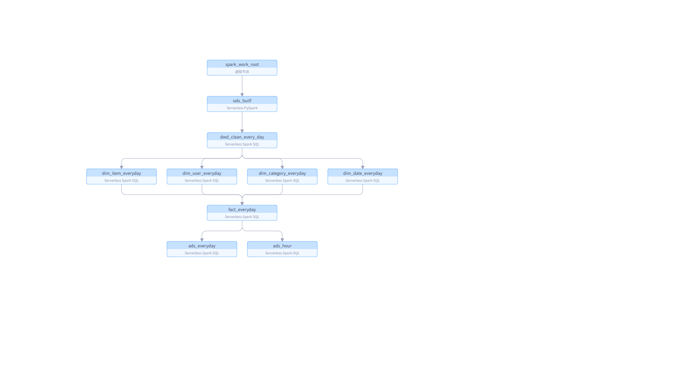
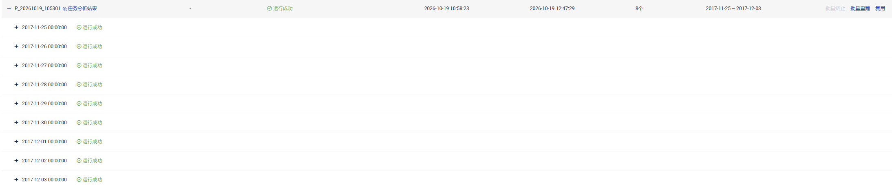
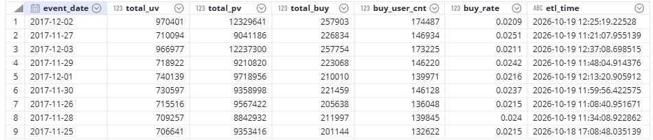

# 基于 DataWorks + Iceberg 的电商离线数仓

在阿里云 DataWorks Serverless Spark 上实现的 T+1 电商用户行为数仓，覆盖 ODS → DWD → DIM / FACT → DWS → ADS 完整链路。数据存放在 OSS，使用 Iceberg 表格式，任务通过 DataWorks 周期调度。

## 技术栈

`DataWorks` · `Serverless Spark` · `PySpark` · `Spark SQL` · `OSS` · `Iceberg` · `Parquet`

## 数据与产出

- 数据源：淘宝用户行为数据集（UserBehavior），约 1.1 亿行，时间范围 2017-11-25 ~ 2017-12-03
- 处理粒度：按 `event_date` 分区，T+1 增量覆写
- 产出：13 张表，覆盖 5 个分层（ODS / DWD / DIM+FACT / DWS / ADS）
- 调度：9 个业务日期分区全部运行成功

## 架构



| 分层 | 表 | 说明 |
| --- | --- | --- |
| ODS | `taobao_behavior` | 原始行为明细，按日期分区 |
| DWD | `dwd_taobao_behavior` | 去重、字段标准化、补充 `event_hour` |
| DIM | `dim_user` / `dim_item` / `dim_category` / `dim_date` | 用户、商品、类目、日期维度 |
| FACT | `fact_user_behavior` | 用户-商品-类目-行为粒度的日汇总事实 |
| DWS | `dws_user_behavior_day` / `dws_item_behavior_day` / `dws_category_behavior_day` / `dws_hour_behavior_day` | 用户、商品、类目、小时级日指标 |
| ADS | `ads_daily_overview` / `ads_hour_traffic_day` | 每日大盘、分时流量与转化 |

## 核心实现

### ODS：接入与质量门禁

- PySpark 显式声明 `user_id / item_id / category_id / behavior_type / timestamp` schema，读取 OSS 上按日期拆分的 CSV
- 非空、正数、行为类型枚举、时间戳范围四类校验
- 脏数据占比超过 5% 直接抛异常终止任务；待写入行数为 0 时禁止覆盖分区
- 静态分区 `INSERT OVERWRITE`，显式指定 `event_date`，保证重跑幂等

### DWD：明细清洗

- `ROW_NUMBER()` 按 `(user_id, item_id, behavior_type, behavior_time)` 去重
- `lower(trim(behavior_type))` 统一行为类型
- 从时间戳派生 `event_date` 与 `event_hour`，供下游按日期、小时聚合

### DIM：维度建模

- `dim_user` / `dim_item` 使用 `MERGE INTO` 做增量累积：活跃天数、累计 PV / 购买 / 加购 / 收藏、用户价值与活跃度分层
- `dim_date` 通过 `LEFT ANTI JOIN` 只插入新日期，避免重复
- `dim_category` 按商品数划分热门 / 一般 / 小众 / 冷门类目

### DWS / ADS：指标与应用层

- 四张 DWS 表统一 `buy / pv` 口径，使用 `NULLIF` 防止除零
- ADS 每日大盘产出 UV、PV、购买次数、购买用户数与转化率
- ADS 分时表关联 `dim_date` 标注周末，用于分析时段流量差异

## 调度与运行结果



- 每日 00:25 触发，`bizdate` 作为业务日期参数贯穿各节点
- 依赖链：`ods_builf` → `dwd_clean_every_day` → 4 个 DIM 节点 → `fact_everyday` → `ads_everyday` / `ads_hour`
- 支持补数据与失败重跑；截图为 9 个连续分区全部成功

## ADS 结果示例



| event_date | total_uv | total_pv | total_buy | buy_user_cnt | buy_rate |
| --- | ---: | ---: | ---: | ---: | ---: |
| 2017-12-02 | 970,401 | 12,329,641 | 257,903 | 174,487 | 0.0209 |
| 2017-12-03 | 966,977 | 12,237,300 | 257,754 | 173,225 | 0.0211 |
| 2017-12-01 | 740,139 | 9,718,956 | 210,010 | 139,971 | 0.0216 |

`buy_rate` 为购买次数 / 浏览次数。

## 目录结构

```
.
├── data_in/    建库、原始 CSV 按日期拆分
├── ods/        ODS 建表、接入与质量校验
├── dwd/        DWD 建表、明细清洗
├── dim/        维度表与事实表（DataWorks 导出目录，fact 节点与 dim 同目录）
├── dws/        DWS 建表与日指标计算
├── ads/        ADS 建表与结果表计算
└── docs/images/  架构、调度与结果截图
```

## 运行方式

1. 将 `UserBehavior.csv` 上传到 OSS，并把脚本中的 `oss://your-bucket` 替换为实际 bucket
2. 运行 `data_in/split_2.py`，按 `event_date` 拆分原始数据
3. 执行 `data_in/create_base.sql` 及各层 `*_create_table.sql` 建库建表
4. 在 DataWorks 中配置 `bizdate` 参数与节点依赖，按 ODS → DWD → DIM/FACT → DWS → ADS 顺序周期调度
5. 本地或 EMR 运行时，ODS 脚本从 `spark.emr.SKYNET_BIZDATE` 读取业务日期

## 脱敏与说明

- OSS bucket 统一替换为 `your-bucket`
- 未提交 DataWorks 导出的 `.dataworks/metadata.json` 与 `.schedule.json`，其中包含 workspace / tenant / owner 等内部标识
- `dws/create_table.sql` 与 `ads/ads_create_table.sql` 在导出缺失 DDL 的情况下按下游 `INSERT` 字段补齐，便于本地复现

## 已知限制

- `dim_user` / `dim_item` 的累计指标按天累加，同一分区重复运行会重复计数；补数前需先回滚当日增量
- DataWorks 中的 DWS 节点目前只依赖根节点，未挂到 `fact_everyday` 下游；生产环境应补齐依赖，避免读写时序问题
